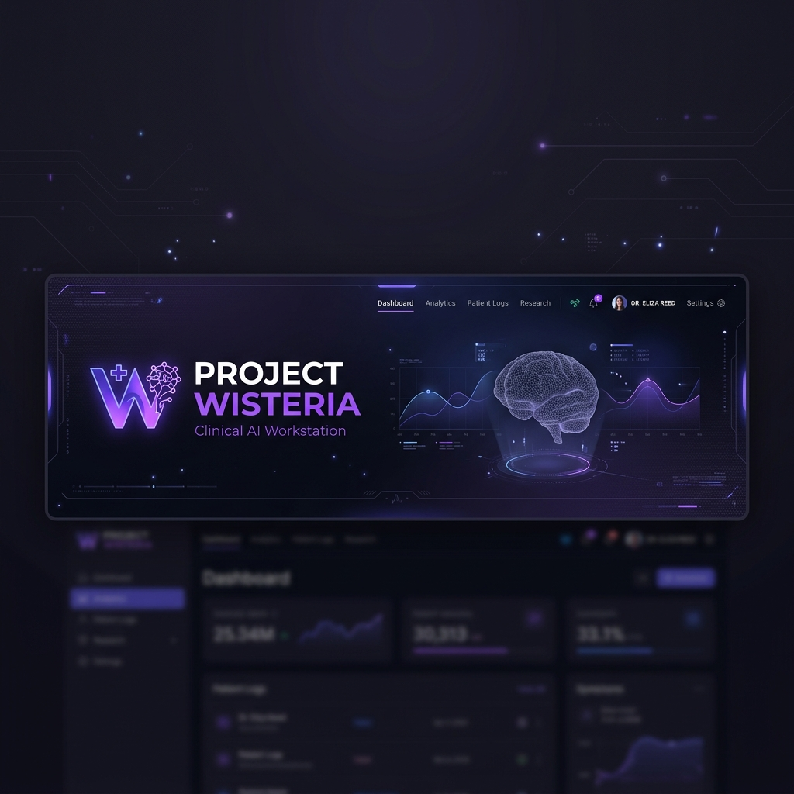
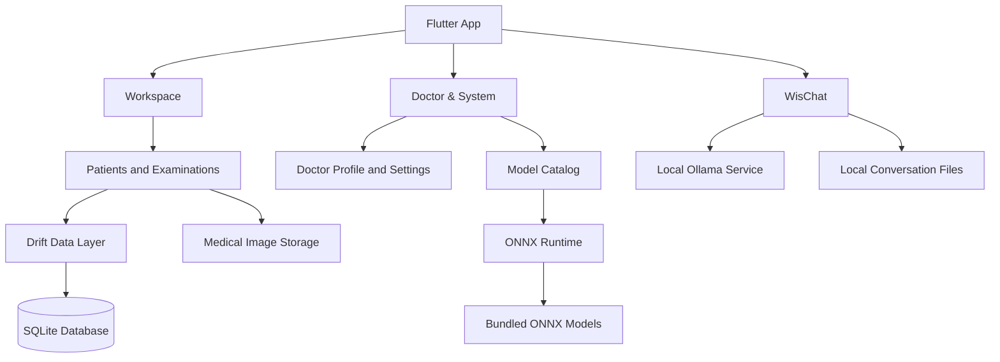

# 🌸 Wisteria

Offline-first clinical workflow tooling for patient records, medical examinations, local AI inference, and a doctor-facing workspace built with Flutter.



[](https://flutter.dev/)
[](https://learn.microsoft.com/en-us/windows/)
[](https://drift.simonbinder.eu/)
[](https://onnxruntime.ai/)
[](https://github.com/FazilPRaphi/Wisteria)

## Overview

Wisteria is a Flutter-based clinical workstation intended for offline-first workflows in a healthcare setting. It focuses on keeping patient records and examination data local to the machine while offering lightweight AI-assisted tools for image analysis and local conversational assistance.

The project is designed for academic and prototype use. It is not a certified medical device and should not be used as a standalone diagnostic tool.

## Features

- Patient registration, searching, and record management
- Medical history and examination tracking
- Doctor profile and clinic information management
- Local storage of patient and exam data using Drift + SQLite
- Medical image handling and local file storage
- ONNX-based inference for bundled medical image models
- WisChat integration with a local Ollama service
- Light and dark theme support
- Desktop-first interface optimized for clinical review workflows

## Current capabilities

- Patient onboarding and record review
- Examination creation and note capture
- Local AI model testing for chest X-ray and brain MRI workflows
- Local LLM conversation support through Ollama
- Settings and runtime information screens
- Offline-first data storage and local processing

## Important note

Wisteria is under active development. Medical image analysis and AI-generated suggestions are intended to support clinical review, not replace the judgement of a qualified healthcare professional.

## Tech stack

| Technology | Purpose |
| --- | --- |
| Flutter | UI framework for cross-platform app development |
| Dart | Application language |
| Drift | Typed local database layer |
| SQLite | Local relational database storage |
| ONNX Runtime | Local model inference |
| Ollama | Local LLM service for WisChat |
| Flutter Markdown | Rendering chat responses in Markdown |
| path_provider | Local file and app-data access |
| file_picker | File selection and import workflows |
| image | Image processing helpers |
| pdfrx | PDF-related functionality |

## Architecture overview



## Project structure

```text
Wisteria/
├── android/                  # Android project files
├── ios/                      # iOS project files
├── linux/                    # Linux desktop project files
├── macos/                    # macOS desktop project files
├── windows/                  # Windows desktop project files
├── web/                      # Web project files
├── assets/
│   ├── images/
│   ├── logo/
│   └── models/
│       ├── brain_tumor_resnet18.onnx
│       ├── dr_resnet18.onnx
│       ├── pneumonia_resnet18.onnx
│       └── evaluation_report.json
├── lib/
│   ├── core/                 # Database, services, models, storage, theme
│   ├── features/             # Patient, examination, model and UI modules
│   ├── app_shell.dart
│   └── main.dart
├── test/
│   ├── widget_test.dart
│   ├── offline_model_verification_test.dart
│   └── diabetic_retinopathy_model_test.dart
├── analysis_options.yaml
├── pubspec.yaml
├── pubspec.lock
├── README.md
├── LICENSE
└── .gitignore
```

## Getting started

### Prerequisites

For desktop development on Windows, install:

- [Flutter SDK](https://docs.flutter.dev/get-started/install)
- [Git](https://git-scm.com/downloads)
- [Visual Studio 2022](https://visualstudio.microsoft.com/) with the Desktop development with C++ workload

Optional for AI features:

- [Ollama](https://ollama.com/) for WisChat
- A compatible local model such as `gemma3:4b`

### 1. Clone the repository

```bash
git clone https://github.com/FazilPRaphi/Wisteria.git
cd Wisteria
```

### 2. Install Flutter dependencies

```bash
flutter pub get
```

### 3. Verify the environment

```bash
flutter doctor
```

Resolve any issues reported by Flutter before running the app.

### 4. Run the app

```bash
flutter run -d windows
```

### 5. Optional: configure WisChat

Install Ollama and pull the model used by the app:

```bash
ollama pull gemma3:4b
```

Then start Ollama locally so the WisChat tab can communicate with `http://localhost:11434`.

## Testing

Run the Flutter tests with:

```bash
flutter test
```

Focused checks can also be run on individual files, for example:

```bash
flutter test test/widget_test.dart
flutter test test/offline_model_verification_test.dart
```

## Local data and privacy

Wisteria stores clinical information locally on the device. The app uses local SQLite storage for patient and examination data, while model and chat-related data are kept in local application storage paths.

Important reminders:

- Data remains local unless you explicitly export or back it up
- AI output should be reviewed by a qualified clinician before acting on it
- Do not use real patient data in development or testing environments
- Keep the device, backups, and local files protected and access-controlled

## Contributing

Contributions are welcome. To contribute:

1. Fork the repository or create a branch from the current main branch
2. Make your change with clear, focused edits
3. Run relevant tests and validate the app behavior
4. Submit a pull request with a description of the change and testing performed

Please avoid committing sensitive patient information, credentials, secrets, or other personal data.

## License

This project is licensed under the MIT License. See [LICENSE](LICENSE) for details.

---

<div align="center">

Built with care for offline-first clinical workflows.

🌸 Project Wisteria

</div>
